# PROJECT RELAY 2.0 — Operation Ashfall

> *"When humans can't reach, intelligence goes further."*

RELAY 2.0 is an open-world 3D autonomous rescue robotics adventure and simulation built with **Three.js (WebGL2)**, **React + TypeScript**, **Express + WebSockets**, **SQLite (`node:sqlite`)**, and the **Gemini API (`@google/genai`)**.

## Published Website

- **Live App:** [https://ais-pre-ljwz73q3rpj5y2ophd4rwn-885189251864.europe-west2.run.app](https://ais-pre-ljwz73q3rpj5y2ophd4rwn-885189251864.europe-west2.run.app)

## Demo Media

### Screen Recording

<video src="./public/media/relay-2-screenshots/screen-recording.mp4" controls width="100%">
  <a href="./public/media/relay-2-screenshots/screen-recording.mp4">Watch the RELAY 2.0 screen recording</a>
</video>

### Screenshots

<details>
<summary>View all 38 screenshots</summary>

| Screenshot | Screenshot |
| --- | --- |
| [<br><sub>01. Home screen and campaign overview</sub>](./public/media/relay-2-screenshots/screenshot-01.png) | [<br><sub>02. Operations map and available missions</sub>](./public/media/relay-2-screenshots/screenshot-02.png) |
| [<br><sub>03. Mission planning and command controls</sub>](./public/media/relay-2-screenshots/screenshot-03.png) | [<br><sub>04. Field operations and hazard navigation</sub>](./public/media/relay-2-screenshots/screenshot-04.png) |
| [<br><sub>05. Survivor recovery in the field</sub>](./public/media/relay-2-screenshots/screenshot-05.png) | [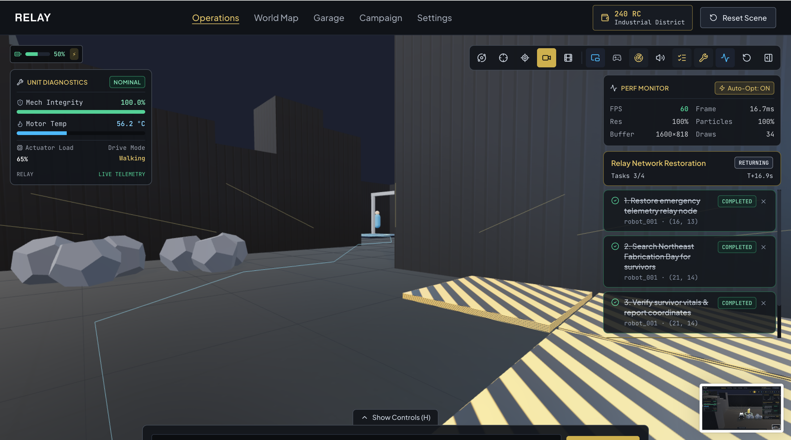<br><sub>06. Hazard zone and obstacle route</sub>](./public/media/relay-2-screenshots/screenshot-06.png) |
| [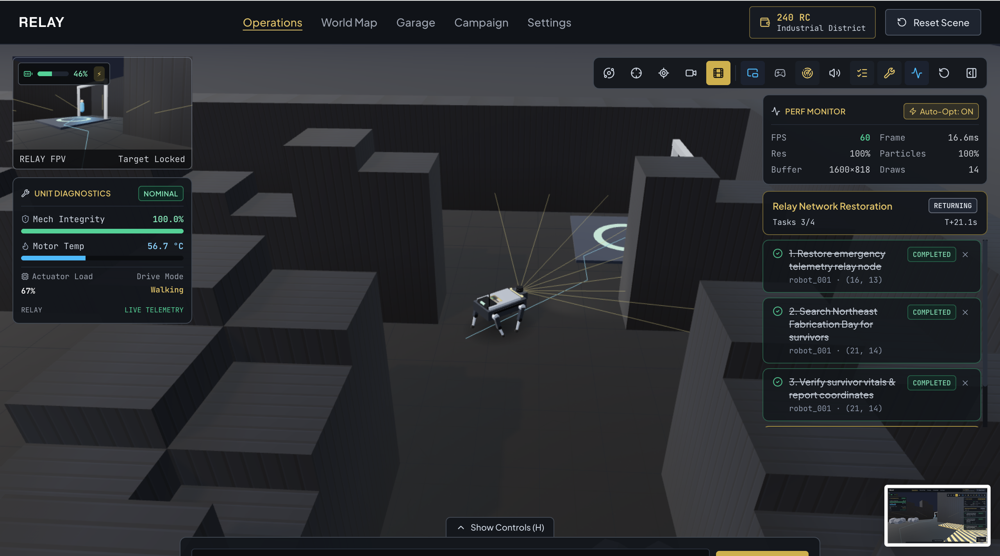<br><sub>07. Rubble corridor navigation</sub>](./public/media/relay-2-screenshots/screenshot-07.png) | [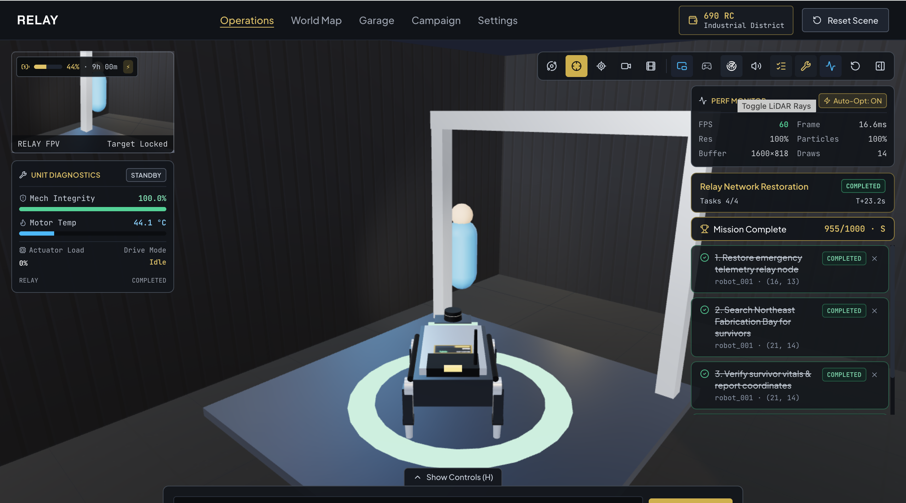<br><sub>08. Robot launch pad and status</sub>](./public/media/relay-2-screenshots/screenshot-08.png) |
| [<br><sub>09. Completed mission telemetry and objectives</sub>](./public/media/relay-2-screenshots/screenshot-09.png) | [<br><sub>10. Robot diagnostics panel</sub>](./public/media/relay-2-screenshots/screenshot-10.png) |
| [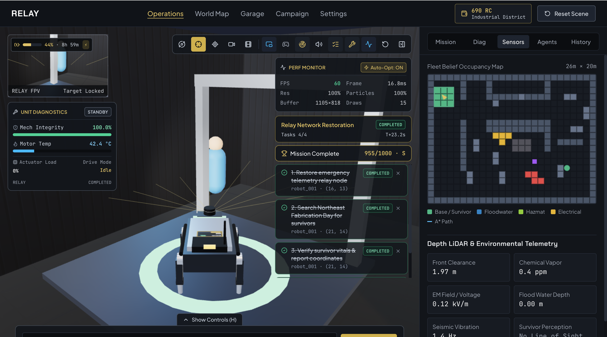<br><sub>11. Fleet map and environmental sensors</sub>](./public/media/relay-2-screenshots/screenshot-11.png) | [<br><sub>12. AI agent activity log</sub>](./public/media/relay-2-screenshots/screenshot-12.png) |
| [<br><sub>13. Safety-agent route assessments</sub>](./public/media/relay-2-screenshots/screenshot-13.png) | [<br><sub>14. World map and sector deployments</sub>](./public/media/relay-2-screenshots/screenshot-14.png) |
| [<br><sub>15. RELAY unit overview and loadout</sub>](./public/media/relay-2-screenshots/screenshot-15.png) | [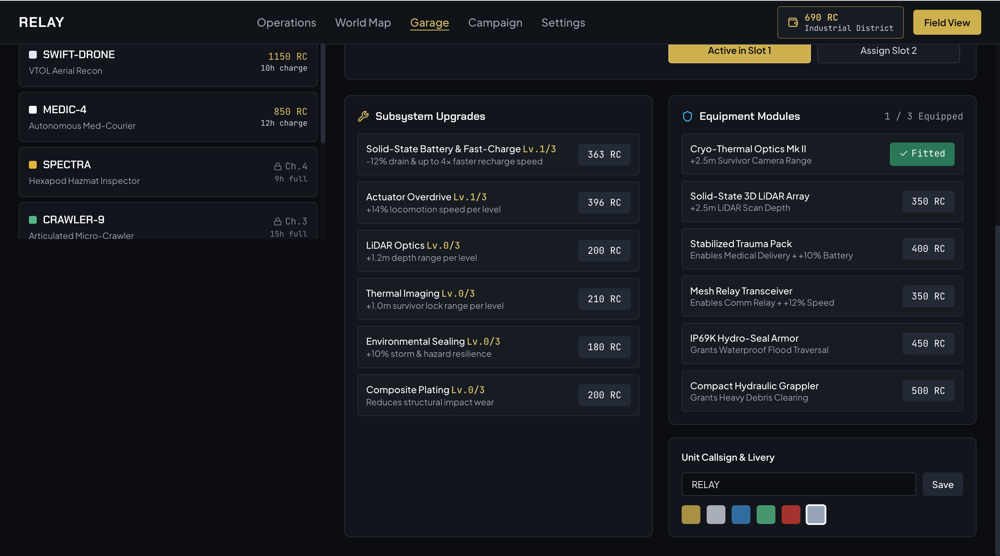<br><sub>16. Unit upgrades and equipment customization</sub>](./public/media/relay-2-screenshots/screenshot-16.png) |
| [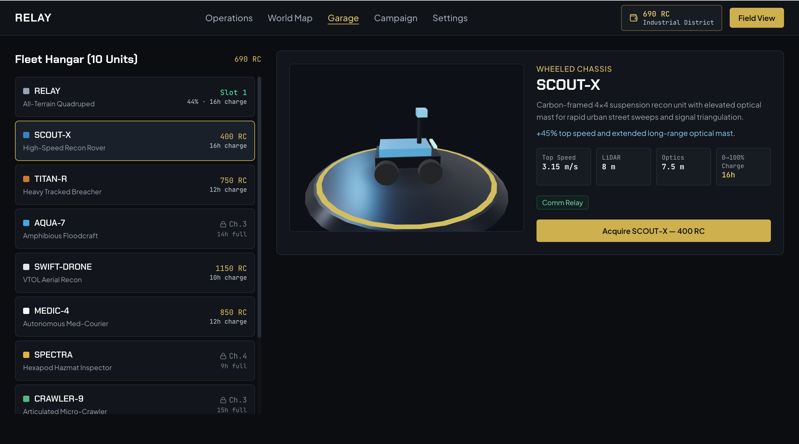<br><sub>17. SCOUT-X recon rover</sub>](./public/media/relay-2-screenshots/screenshot-17.png) | [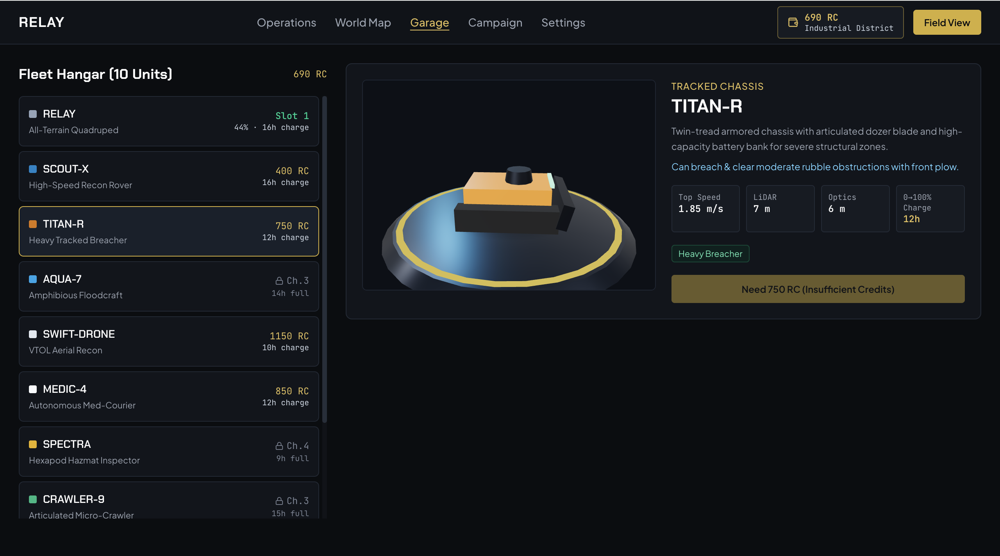<br><sub>18. TITAN-R tracked breacher</sub>](./public/media/relay-2-screenshots/screenshot-18.png) |
| [<br><sub>19. AQUA-7 amphibious craft</sub>](./public/media/relay-2-screenshots/screenshot-19.png) | [<br><sub>20. SWIFT-DRONE aerial scout</sub>](./public/media/relay-2-screenshots/screenshot-20.png) |
| [<br><sub>21. SWIFT-DRONE fleet hangar view</sub>](./public/media/relay-2-screenshots/screenshot-21.png) | [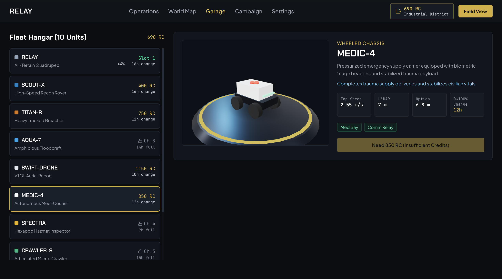<br><sub>22. MEDIC-4 medical carrier</sub>](./public/media/relay-2-screenshots/screenshot-22.png) |
| [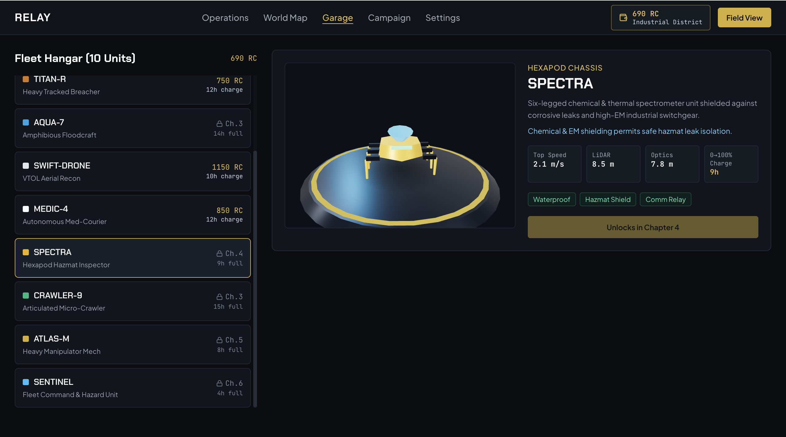<br><sub>23. SPECTRA hazmat inspector</sub>](./public/media/relay-2-screenshots/screenshot-23.png) | [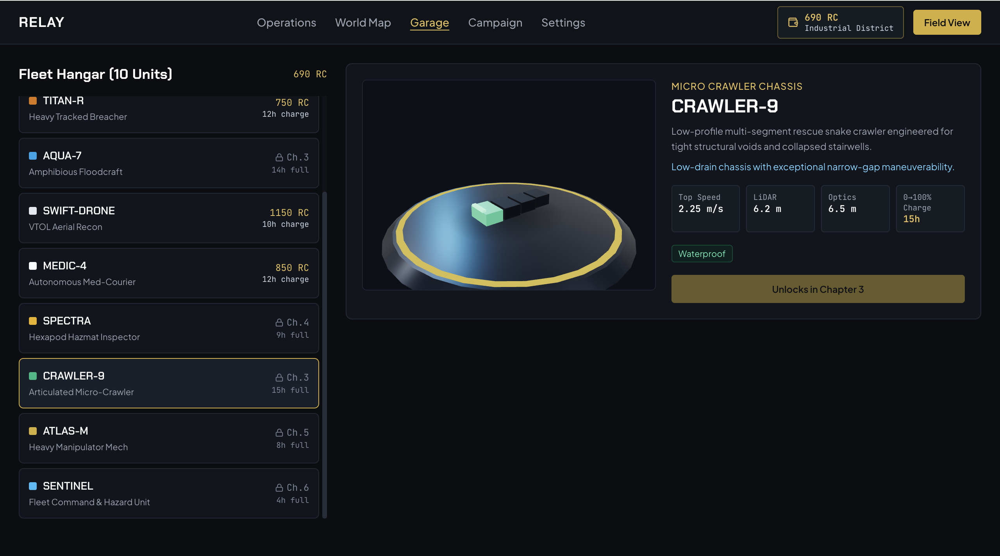<br><sub>24. CRAWLER-9 micro crawler</sub>](./public/media/relay-2-screenshots/screenshot-24.png) |
| [<br><sub>25. ATLAS-M heavy manipulator</sub>](./public/media/relay-2-screenshots/screenshot-25.png) | [<br><sub>26. SENTINEL fleet command unit</sub>](./public/media/relay-2-screenshots/screenshot-26.png) |
| [<br><sub>27. Campaign mission overview</sub>](./public/media/relay-2-screenshots/screenshot-27.png) | [<br><sub>28. Industrial District contracts</sub>](./public/media/relay-2-screenshots/screenshot-28.png) |
| [<br><sub>29. Meridian City contracts</sub>](./public/media/relay-2-screenshots/screenshot-29.png) | [<br><sub>30. Old Quarter contracts</sub>](./public/media/relay-2-screenshots/screenshot-30.png) |
| [<br><sub>31. Port Meridian contracts</sub>](./public/media/relay-2-screenshots/screenshot-31.png) | [<br><sub>32. Highland Province contracts</sub>](./public/media/relay-2-screenshots/screenshot-32.png) |
| [<br><sub>33. Desert Corridor contracts</sub>](./public/media/relay-2-screenshots/screenshot-33.png) | [<br><sub>34. Research Valley contracts</sub>](./public/media/relay-2-screenshots/screenshot-34.png) |
| [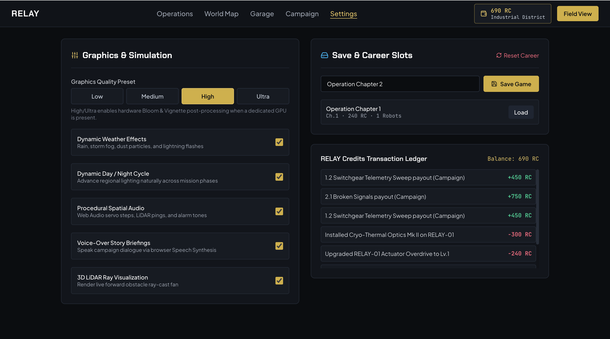<br><sub>35. Graphics and simulation settings</sub>](./public/media/relay-2-screenshots/screenshot-35.png) | [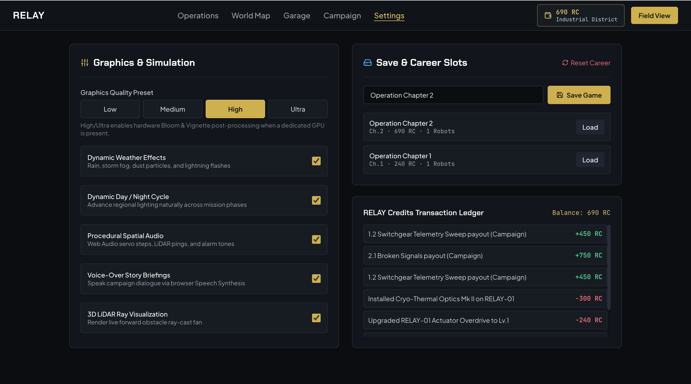<br><sub>36. Career saves and transaction ledger</sub>](./public/media/relay-2-screenshots/screenshot-36.png) |
| [<br><sub>37. Save-load confirmation</sub>](./public/media/relay-2-screenshots/screenshot-37.png) | [<br><sub>38. Rapid-charge and credit store</sub>](./public/media/relay-2-screenshots/screenshot-38.png) |

</details>

## Key Features

- **Operation Ashfall Campaign (6 Chapters + Side Contracts)**: Explore 7 interconnected Meridian districts (*Industrial District*, *Meridian City*, *Old Quarter*, *Port Meridian*, *Highland Province*, *Desert Corridor*, *Research Valley*) culminating in a player-driven ethical choice.
- **10 Distinct Procedural 3D Robots**: Acquire and deploy `RELAY-01`, `SCOUT-X`, `TITAN-R`, `AQUA-7`, `SWIFT-DRONE`, `MEDIC-4`, `SPECTRA`, `CRAWLER-9`, `ATLAS-M`, and `SENTINEL`—each with unique multi-part 3D chassis, animations, and terrain capabilities.
- **Multi-Agent Architecture**:
  - **Commander AI (`server/commanderAgent.ts` & `src/agents/commanderParser.ts`)**: Translates natural-language orders into structured mission tasks using Gemini 4 Hydrogen with automatic deterministic fallback.
  - **Fleet Coordinator (`src/agents/fleetCoordinator.ts`)**: Distributes objectives simultaneously across Slot 1 & Slot 2 active robots matched by capability.
  - **Navigation Agent (`src/agents/navigationAgent.ts`)**: Deterministic A* pathfinder operating strictly on the robot fleet's live belief grid (`flood_water`, `chemical_hazard`, `rubble`, `mountain_cliff`, `road`, `bridge`).
  - **Safety Agent (`src/agents/safetyAgent.ts`)**: Independent deterministic guardrail vetoing hazard entries, incompatible water/chemical exposure, and low-battery expeditions.
  - **Logistics Agent (`src/agents/logisticsAgent.ts`)**: Evaluates fleet readiness, hull wear, weather sealing, and repair projections.
- **Economy, Upgrades & Save Slots (`server/db.ts`)**: Earn **RELAY Credits (RC)**, purchase units, upgrade 6 subsystems (`Lv.0–3`), fit equipment modules (up to 3 per unit), customize callsigns/paint, and manage manual SQLite save slots.
- **Open-World Visuals & Camera Suite**: Dynamic Day/Night cycles, reactive Weather particles (`rain`, `heavy_rain`, `thunderstorm`, `fog`, `dust_storm`), hardware-gated `UnrealBloomPass` post-processing, 5 camera modes (`Orbit`, `3rd Person`, `Follow`, `Robot FPV` + PiP, `Cinematic`), and W/A/S/D safety-guarded manual driving.

## Quick Start

```bash
npm install
npm test
npm run build
npm run dev
```

Open `http://localhost:3000`.
